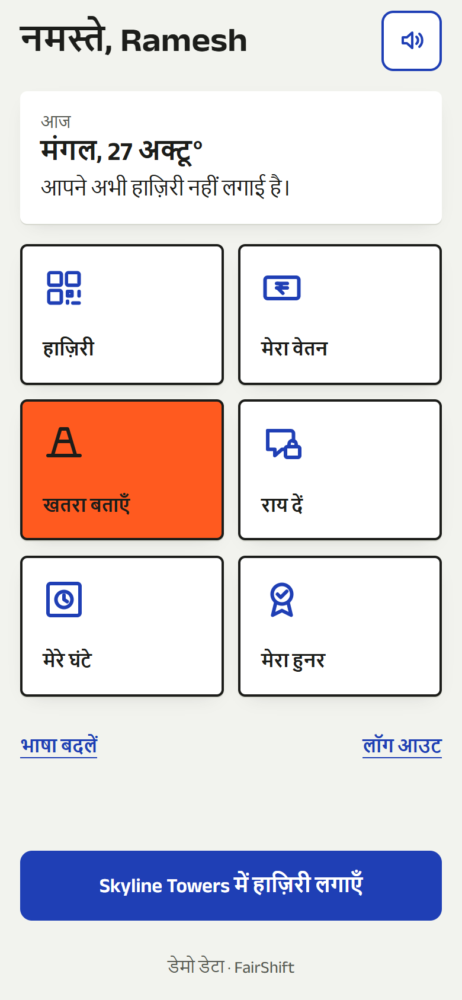

# FairShift

Fair pay. Safe sites. A voice that counts.

FairShift is a phone-first workforce platform for shift workers and the people who manage them. A worker checks in at the gate, sees exactly how their pay was worked out (overtime included), reports a hazard in their own language and gives feedback without being identified. A supervisor sees the same data as a live console: who is on site, which hazards are past their deadline, who is overworked and which teams are likely to lose people.

It was built for PromptWars 2026 (SRM ACM Student Chapter x Hack2Skill x Google for Developers), theme **UN SDG 8: Decent Work and Economic Growth**. It runs on two sectors with one data model: **construction** (Skyline Towers) and **college campus facilities**. The hospital case is documented in [docs/industry-use-cases.md](docs/industry-use-cases.md).

<!-- METRICS -->

Measured on 2026-10-27 with `npm test -- --coverage`, `npm run typecheck`, `npm run lint` and `npm run build`:

| Check                                      | Result                                                                                               |
| ------------------------------------------ | ---------------------------------------------------------------------------------------------------- |
| Tests                                      | **149 passed**, 0 failed (22 files: domain, server, UI components, admin, i18n)                      |
| Rule-engine coverage (`src/server/domain`) | **99.42%** statements · **96.79%** branches · **100%** functions                                     |
| TypeScript (`tsc --noEmit`, strict)        | 0 errors                                                                                             |
| ESLint (`--max-warnings 0`)                | 0 errors, 0 warnings                                                                                 |
| Production build (`next build`)            | Passes, 40 routes                                                                                    |
| Credentials in the repo                    | None: `MONGODB_URI`, `GEMINI_API_KEY` and `SESSION_SECRET` live only in Vercel environment variables |

## Chosen vertical

**PromptWars 2026 × SRM ACM Student Chapter: "FairShift: Decent Work Platform", UN SDG 8 (Decent Work and Economic Growth).**

- **Personas:** shift workers (construction masons and helpers, campus housekeeping and security staff) and their supervisors, plus a regional HR lead who manages more than one organisation.
- **Sectors running live:** a construction site (Skyline Towers, Chennai) and a college campus (Campus Facilities), both on one data model.

## Approach and logic

- **Every number comes from tested rules, not from AI.** Pure functions in `src/server/domain` compute:
  - overtime: OSH Code 2020, 8 h/day and 48 h/week per ISO week, paid at 2×
  - payslips: PF 12% of basic up to ₹15,000, ESI 0.75% when gross ≤ ₹21,000
  - fatigue: > 48 h in 7 days, a shift > 10 h, < 10 h rest, 7 days without a break
  - hazard deadlines: 1 h / 4 h / 24 h / 72 h, with escalation computed on read
  - quit-risk: 0–100 with its top 3 reasons
  - anonymity: k ≥ 3 and PII scrubbing, including Hindi and Tamil names
- **Decisions use the user's context.**
  - The worker's own shifts drive their overtime, payslip and fatigue warnings.
  - Their reports drive their status timeline.
  - The supervisor sees escalations, fatigue and quit-risk ranked for the sector they are allowed to view.
- **Gemini only explains.** It explains a payslip in plain words, turns a spoken Hindi or Tamil hazard report into an English summary with a suggested severity (a human confirms it), and summarises the week. Every AI call has a timeout and a rule-based fallback.
- **Designed for the real user.** The app is voice-first, uses icons with one word, works in three languages, has a light high-contrast theme for sunlight, and keeps the worker routes free of animation libraries for basic phones. See [docs/design-system.md](docs/design-system.md).

## How the solution works

1. **Check in.** A worker scans the rotating QR at the site gate with the phone camera, or uses GPS. If signed out, they enter phone + PIN, and the scanned code is kept through login.
2. **Shift record.** The check-in and check-out create a shift record. The rule engines turn those shifts into hours, overtime, fatigue flags and a line-by-line payslip that can be read aloud.
3. **Hazard report.** A hazard is spoken in the worker's language, optionally anonymous. It lands in the supervisor's safety queue with a deadline, and escalates by itself if nobody acknowledges it.
4. **Feedback.** Anonymous feedback feeds a team heatmap that stays hidden until 3 people answer.
5. **Supervisor console.** The console shows on-site counts, a 14-day attendance chart, escalated hazards and an explainable quit-risk list, for every sector the admin may access.

The full user flows, the end-to-end hazard sequence and the architecture diagram are in **[docs/user-flow-and-architecture.md](docs/user-flow-and-architecture.md)**. What sets the design apart is in **[docs/novelty.md](docs/novelty.md)**.

## Assumptions made

- **Location and time:** workers and sites are in India, and a "day" is an IST calendar day.
- **Pay rules:**
  - Overtime defaults are 8 h/day and 48 h/week at 2× (editable per organisation policy).
  - PF is 12% of basic, capped at a ₹15,000 wage. ESI is 0.75% when gross is ≤ ₹21,000.
  - A daily-wage worker's hourly rate is base ÷ 8.
- **Check-in:** the gate QR code rotates every 60 s and accepts ±1 window. An open shift older than 16 h is treated as a missed check-out.
- **Anonymity:** feedback needs at least 3 answers per team-week before results are shown.
- **Devices:** workers use Chrome on Android for voice input and read-aloud. Both hide themselves gracefully when unsupported.
- **Admins:** one admin may manage several organisations.
- **Demo data:** the data is seeded, anchored to the current day and labelled "Demo data". Without `MONGODB_URI`, or if MongoDB is unreachable, the app runs on this seeded in-memory store.

## Screenshots

| Worker home (Hindi)                                                | Payslip (Hindi)                                                   | Supervisor console                                             |
| ------------------------------------------------------------------ | ----------------------------------------------------------------- | -------------------------------------------------------------- |
|  |  |  |

More in [docs/screenshots](docs/screenshots).

## How the problem statement is met

| Requirement         | Where it is implemented                                                                                                                                                                                 |
| ------------------- | ------------------------------------------------------------------------------------------------------------------------------------------------------------------------------------------------------- |
| 3+ working features | Eight, all in the app: shift tracking, payslips, safety reporting, anonymous feedback, skill passport, fatigue alerts, admin dashboard, voice and local language. See the feature table below.          |
| 2 user interfaces   | Worker app `/w` (`app/w`, mobile-first, English / Hindi / Tamil) and admin console `/admin` (`app/admin`, desktop-first). A public landing page `/` and a public skill verify page `/passport/[token]`. |
| 2+ sectors          | Construction and college campus, switchable live in the admin console (`src/server/services/adminViews.ts`, sector switcher). Seed data for both is in `src/server/seed/seed.ts`.                       |

| Feature                  | Worker side                                               | Employer side                                                      | Code                                                                            |
| ------------------------ | --------------------------------------------------------- | ------------------------------------------------------------------ | ------------------------------------------------------------------------------- |
| Shift tracking           | QR or GPS check-in, automatic overtime                    | Live on-site count, rotating gate QR kiosk                         | `src/server/domain/{overtime,qrCode,geofence}.ts`, `app/admin/sites/[id]/kiosk` |
| Clear payslips           | Line-by-line payslip, read aloud, plain-words explanation | Payroll rules per organisation                                     | `src/server/domain/payslip.ts`, `src/server/ai/gemini.ts`                       |
| Safety reporting         | Spoken or typed report, optional anonymity                | Queue with response deadlines, auto-escalation, AI English summary | `src/server/domain/hazardSla.ts`, `app/admin/(console)/safety`                  |
| Honest feedback          | Four face-scale questions, no identity stored             | Team heatmap, hidden under 3 answers, PII scrubbed                 | `src/server/domain/anonymity.ts`, `src/components/admin/FeedbackHeatmap.tsx`    |
| Skill passport           | Shareable verification link                               | Verified records                                                   | `src/server/domain/skills.ts`, `app/passport/[token]`                           |
| Fatigue alerts           | Warning on unsafe hours or rest                           | Fatigue flags per worker                                           | `src/server/domain/fatigue.ts`                                                  |
| Admin dashboard          | -                                                         | Attendance chart, hazards, quit-risk with top reasons              | `app/admin/(console)`, `src/server/domain/quitRisk.ts`                          |
| Voice and local language | Read-aloud, voice input, 3 languages                      | Local-language reports summarised in English                       | `src/i18n`, `src/components/ui`                                                 |

## The six AI-evaluation criteria

| Criterion         | What we did and where                                                                                                                                                                                                                                                                                                                                                                                                                                                             |
| ----------------- | --------------------------------------------------------------------------------------------------------------------------------------------------------------------------------------------------------------------------------------------------------------------------------------------------------------------------------------------------------------------------------------------------------------------------------------------------------------------------------- |
| Code quality      | Three layers with one direction of dependency: pure rule engines in `src/server/domain`, repositories in `src/server/repos` (in-memory and MongoDB behind one interface), services in `src/server/services`. Shared types in `src/shared`. Strict TypeScript and ESLint with zero warnings allowed (`npm run lint`).                                                                                                                                                              |
| Security          | No secrets in the repo (`.env.example` has names only). Sessions are HMAC-signed `httpOnly` cookies (`src/server/auth/session.ts`). PINs and passwords are scrypt-hashed. Inputs are validated with zod (`src/shared/schemas.ts`). Login is rate-limited. `proxy.ts` guards `/w` and `/admin`. Security headers and a CSP are set in `next.config.ts`. Admin mutations re-check that the hazard belongs to the organisation. Feedback has no worker id and is hidden below k = 3. |
| Efficiency        | Next.js `output: "standalone"` image on `node:22-alpine`. The worker app ships no animation library; GSAP is loaded only on `/` and `/admin`. Only the Latin and one Indic font script load. Server Components do the data work. The in-memory backend needs no network.                                                                                                                                                                                                          |
| Testing           | Unit tests for every rule engine (`tests/domain`), services and routes (`tests/server`), and components (`tests/components`). CI runs `vitest run --coverage` on every push (`.github/workflows/ci.yml`).                                                                                                                                                                                                                                                                         |
| Accessibility     | Tokens chosen for WCAG contrast, a 3 px focus ring, skip link, `lang` per locale, targets of 48 px or more, `aria-live` stamps, a table fallback for the attendance chart, every status shown as colour plus word plus shape, and `prefers-reduced-motion` honoured everywhere. Full rules in [DESIGN.md](DESIGN.md).                                                                                                                                                             |
| Problem alignment | Each worker pain point and employer blind spot in the problem statement maps to a feature above. See [docs/solution-statement.md](docs/solution-statement.md).                                                                                                                                                                                                                                                                                                                    |

Rules come from code, not from AI. Gemini only explains and summarises, and every AI feature has a rule-based fallback that works with no credentials. AI text is labelled "Explained by AI · check with supervisor".

## Architecture

```
  Worker phone (/w)                     Supervisor desktop (/admin)
  EN / HI / TA, voice                   sector switcher, charts, queues
        |                                         |
        +------------------+----------------------+
                           |
              Next.js 16 App Router (Vercel)
        Server Components + Server Actions + route handlers
                           |
                  proxy.ts  (session guard)
                           |
        +------------------+-------------------+
        |                  |                   |
   src/server/auth    src/server/services   src/server/ai
   signed cookies     workerService         Gemini API (key)
   scrypt, limits     adminService          (8 s timeout,
                      adminViews / workerViews     rule-based fallback)
                           |
                 src/server/domain  (pure rule engines)
        overtime, payslip, fatigue, hazard SLA, quit risk,
        anonymity, geofence, rotating QR, skills
                           |
                  src/server/repos  (one interface)
              +------------+-------------+
              |                          |
        memory (seeded)             MongoDB Atlas
        no MONGODB_URI              MONGODB_URI set
```

## Run locally without credentials

```bash
npm i
cp .env.example .env.local     # optional: DATA_BACKEND already defaults to memory
npm run dev
```

Open http://localhost:3000. With `DATA_BACKEND=memory` the app seeds itself on boot. With no `GOOGLE_CLOUD_PROJECT`, AI features use the rule-based fallbacks. Nothing needs a key.

### Demo accounts

All seeded in `src/server/seed/seed.ts`. This is demo data, not real people.

| Role           | Sign in                       | Secret       | Sector                                     |
| -------------- | ----------------------------- | ------------ | ------------------------------------------ |
| Worker (Hindi) | phone `9876543210`            | PIN `1234`   | Construction, Ramesh Kumar, mason          |
| Worker (Tamil) | phone `9123456789`            | PIN `1234`   | College, Murugan Swaminathan, housekeeping |
| Supervisor     | `admin.skyline@fairshift.org` | `Admin@1234` | Construction                               |
| Supervisor     | `admin.campus@fairshift.org`  | `Admin@1234` | College                                    |

In the admin console the sector switcher lets either demo supervisor view both sectors, so the two-sector model is visible live. A production build would lock each supervisor to their own organisation.

## Environment variables

| Name             | Purpose                                                                         | Default                   |
| ---------------- | ------------------------------------------------------------------------------- | ------------------------- |
| `MONGODB_URI`    | MongoDB Atlas connection string. Leave empty for seeded in-memory data          | empty                     |
| `MONGODB_DB`     | Database name                                                                   | `fairshift`               |
| `DATA_BACKEND`   | Set to `memory` to force in-memory data even when `MONGODB_URI` is set          | empty                     |
| `GEMINI_API_KEY` | Enables Gemini explanations (server-only). Leave empty for rule-based fallbacks | empty                     |
| `GEMINI_MODEL`   | Model name                                                                      | `gemini-2.5-flash`        |
| `SESSION_SECRET` | Key for signing session cookies. Required in production                         | random per process in dev |

There is no `QR_SECRET`: each site carries its own rotating-QR secret in the data store.

## Tests

```bash
npm run typecheck
npm run lint
npm test                 # vitest, all suites
npm run test:coverage    # vitest run --coverage
```

## Deploy to Vercel

```bash
vercel link
printf '%s' "$(openssl rand -hex 32)" | vercel env add SESSION_SECRET production
vercel env add MONGODB_URI production      # MongoDB Atlas connection string (allow 0.0.0.0/0 in Atlas Network Access)
vercel env add GEMINI_API_KEY production   # optional: Gemini explanations
vercel deploy --prod
```

On first request the app creates its indexes and seeds an empty database with the demo data. Without `MONGODB_URI` it runs on seeded in-memory data, which is fine for a demo but resets between serverless instances.

## Repo layout

```
app/                 routes: /, /w (worker), /admin (console), /passport/[token], /api
src/server/          domain, repos, services, auth, ai, seed
src/components/      ui (shared), worker, admin, motion (GSAP), landing, icons
src/shared/          types and zod schemas
tests/               domain, server, components
docs/                plan, design system, use cases, LinkedIn draft
```

Design rules (tokens, type, motion, ban list) are in [DESIGN.md](DESIGN.md).

## Credits

- Typefaces: [Anek](https://github.com/EkType/Anek) by Ek Type and Spline Sans Mono, both under the SIL Open Font License, served through Google Fonts.
- Motion: written with [GSAP](https://gsap.com). The two easing curves ("hop" and "glide") and the line-mask reveal technique are adapted from public GSAP landing-page demos; the components themselves are original to FairShift.
- Labour rules: overtime defaults follow the Occupational Safety, Health and Working Conditions Code, 2020 (8 h/day, 48 h/week, 2× rate).
- Low-literacy design guidance: Medhi et al., Microsoft Research India, and the sources listed in `docs/design-system.md`.

## License

[MIT](LICENSE)
