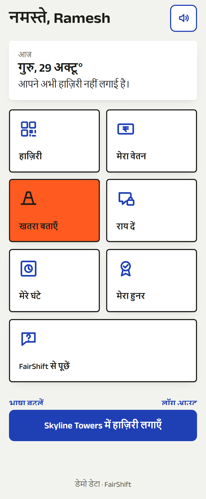
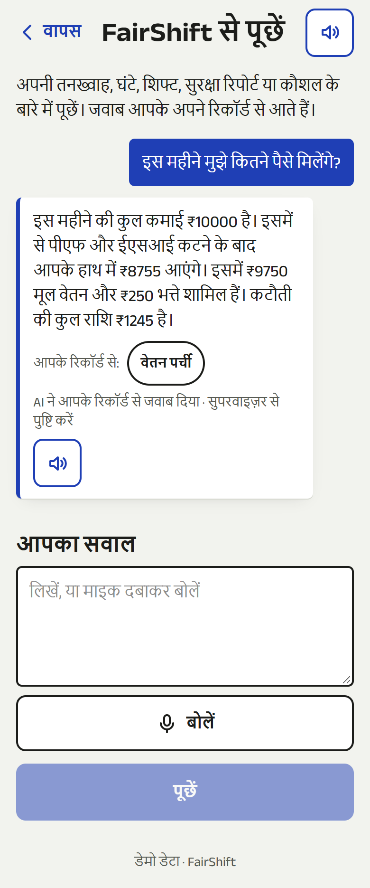
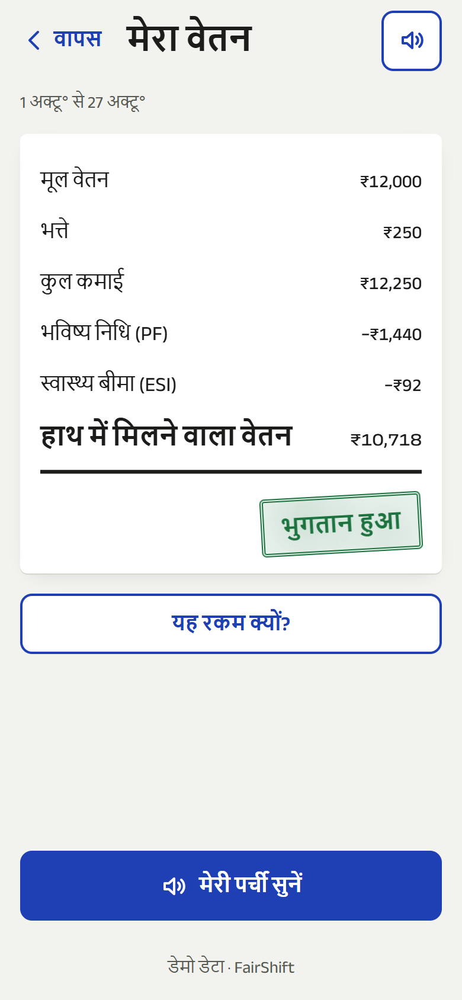
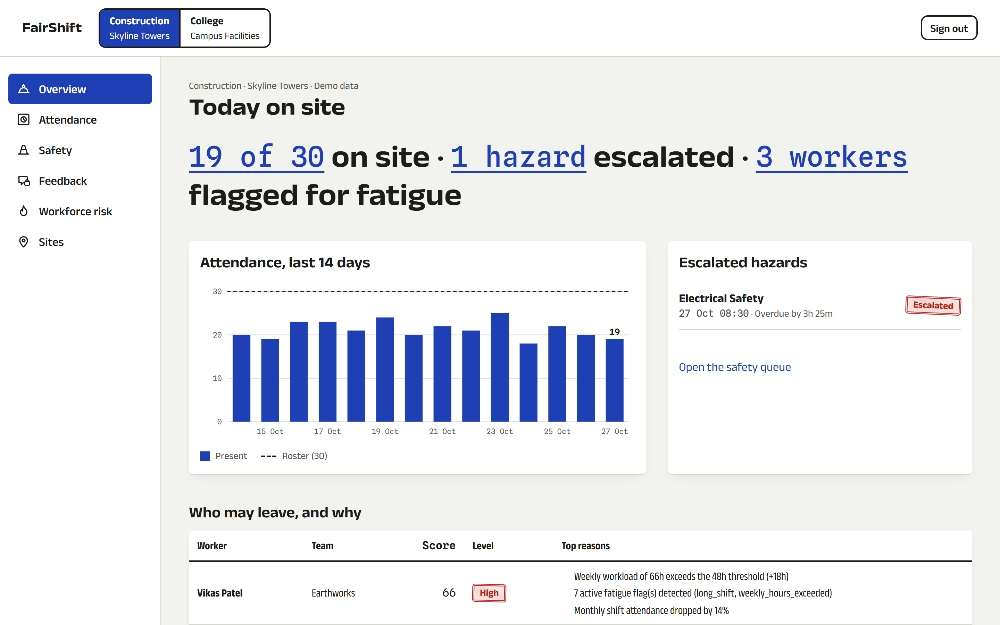
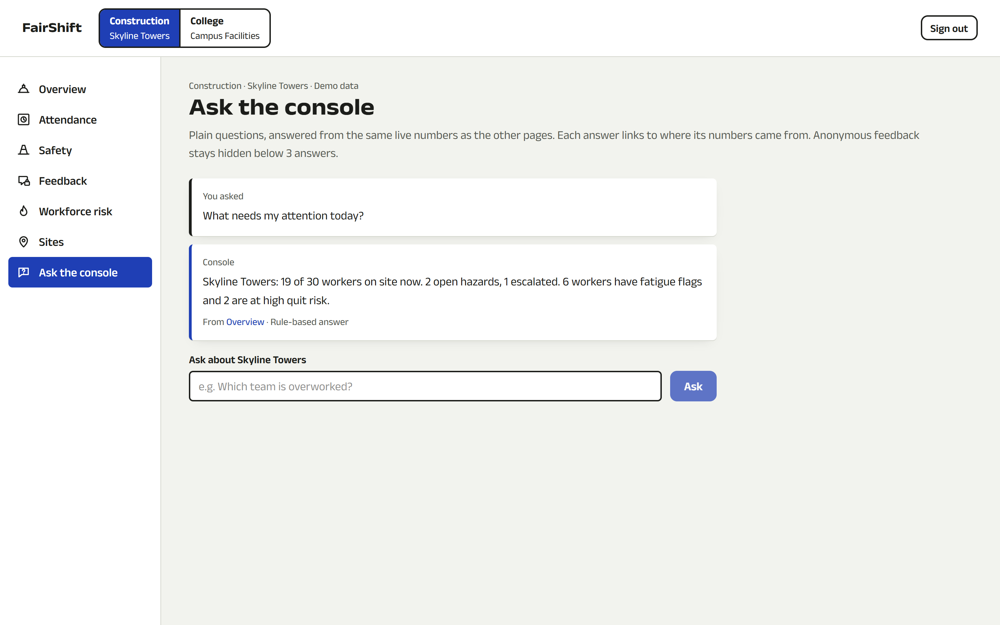
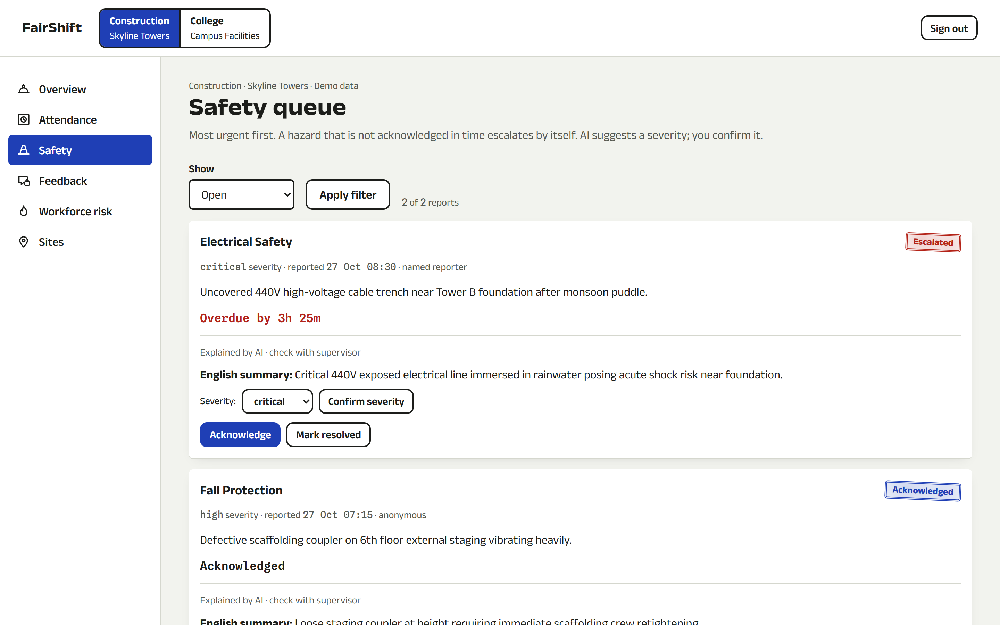
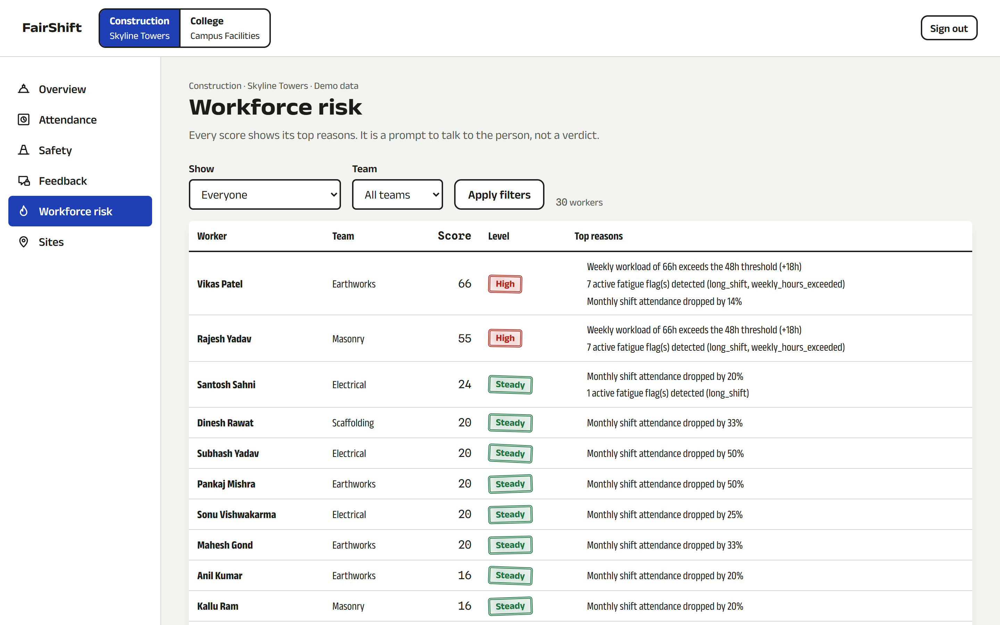
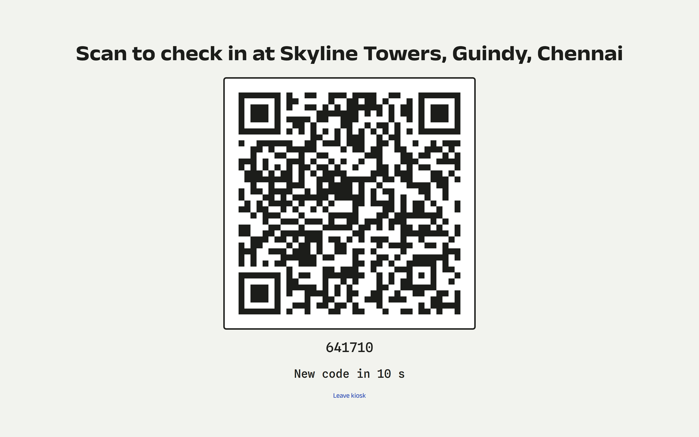
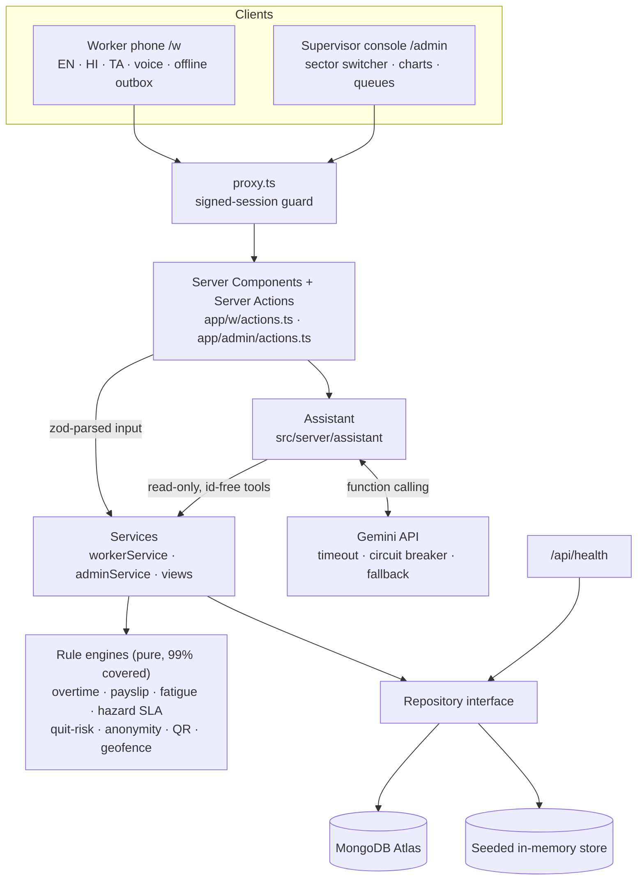
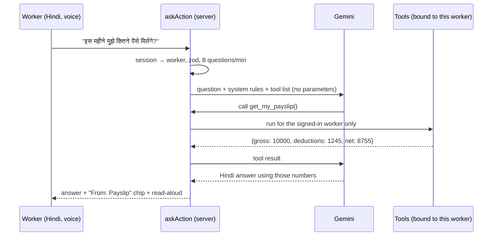

# FairShift

**Fair pay. Safe sites. A voice that counts.**

FairShift is a phone-first platform for shift workers and the supervisors who manage them, built for UN SDG 8 (Decent Work and Economic Growth). A worker can:

- check in at the site gate with a rotating QR code
- see exactly how their pay was worked out, overtime included
- report a hazard by speaking Hindi, Tamil or English
- give feedback without being identified
- ask questions about their own pay, hours and reports, in their own language

The supervisor sees the same records as a live console: who is on site, which hazards are past their deadline, who is overworked, and which teams are about to lose people.

It runs two sectors on one data model, a **construction site** and a **college campus**, and it works offline on the worker's phone.

> PromptWars 2026 × ACM SRM Student Chapter. Ranked **#1** in the AI-evaluated round (97.15 / 100).

| Live demo                                                                               | Worker login                   | Supervisor login                                      |
| --------------------------------------------------------------------------------------- | ------------------------------ | ----------------------------------------------------- |
| **[fairshift-brown.vercel.app](https://fairshift-brown.vercel.app)** (seeded demo data) | phone `9876543210`, PIN `1234` | `admin.regional@fairshift.org`, password `Admin@1234` |

---

## Contents

1. [Quick start](#quick-start)
2. [What it does](#what-it-does)
3. [Screenshots](#screenshots)
4. [Tech stack](#tech-stack)
5. [Architecture](#architecture)
6. [Urima: an assistant that cannot make numbers up](#urima-an-assistant-that-cannot-make-numbers-up)
7. [Error handling and input validation](#error-handling-and-input-validation)
8. [Testing](#testing)
9. [Security](#security)
10. [Environment variables](#environment-variables)
11. [Deployment](#deployment)
12. [Project structure](#project-structure)
13. [Assumptions](#assumptions)
14. [Credits and license](#credits-and-license)

---

## Quick start

You need **Node.js 22** or later (see `.nvmrc`). No database, API key or account is required.

```bash
git clone <this repo> fairshift && cd fairshift
npm ci
npm run dev
```

Open **http://localhost:3000**.

With no `.env.local`, the app does three things on its own:

- seeds an in-memory store with two organisations, 50 workers and three weeks of shifts
- signs sessions with a local development secret
- answers every AI feature with rule-based text

To turn on MongoDB and Gemini, copy `.env.example` to `.env.local` and fill it in (see [Environment variables](#environment-variables)).

Check that it is up:

```bash
curl http://localhost:3000/api/health
# {"status":"ok","dataBackend":"memory","database":"memory","ai":"rule-based fallback","time":"…"}
```

### Other ways to run it

| Goal                        | Command                                                                                                      |
| --------------------------- | ------------------------------------------------------------------------------------------------------------ |
| Production build locally    | `npm run build && SESSION_SECRET=$(openssl rand -hex 32) npm start`                                          |
| Docker (app only)           | `docker build -t fairshift . && docker run -p 3000:3000 -e SESSION_SECRET=$(openssl rand -hex 32) fairshift` |
| Docker with a local MongoDB | `docker compose up --build` (seeds the empty database on first start)                                        |
| Every check CI runs         | `npm run verify` (format, types, lint, tests with coverage thresholds, production build)                     |

### Demo accounts

All demo data is generated in `src/server/seed/`. These are not real people.

| Role                    | Sign in at     | Login                          | Secret       | What you see                                       |
| ----------------------- | -------------- | ------------------------------ | ------------ | -------------------------------------------------- |
| Worker (Hindi)          | `/w`           | `9876543210`                   | PIN `1234`   | Ramesh Kumar, mason, Skyline Towers (construction) |
| Worker (Tamil)          | `/w`           | `9123456789`                   | PIN `1234`   | Murugan Swaminathan, housekeeping, campus          |
| Regional HR (both orgs) | `/admin/login` | `admin.regional@fairshift.org` | `Admin@1234` | Both sectors, with the sector switcher             |
| Site supervisor         | `/admin/login` | `admin.skyline@fairshift.org`  | `Admin@1234` | Construction only                                  |
| Campus supervisor       | `/admin/login` | `admin.campus@fairshift.org`   | `Admin@1234` | College only                                       |

**A 2-minute tour:**

1. Log in as the Hindi worker.
2. Open **उरिमा से पूछें** and tap "इस महीने मुझे कितने पैसे मिलेंगे?". Then type "सीढ़ी के पास बिजली का तार खुला है": Urima fills in an electrical hazard report at "Stop work now" and waits for you to press Send.
3. Open **Pay** and tap read-aloud. The stamp says what is true: DUE until the employer records the payment, then PAID with the date and UTR.
4. Open **खतरा बताएँ** → the earlier ladder report says "marked fixed". Answer "No, still dangerous" and it reopens as escalated (two-key closure).
5. In **Pay**, type less than the payslip in "Did you get the right amount?" and tap "Ask your employer about this": a pay query goes to the employer with a 48-hour deadline. Open **मेरे अधिकार** for where to complain next.
   Back on **मेरे घंटे**, each day has a receipt code; tap one to see the public check page. If the employer answers and the worker taps "not yet", the query offers **a letter to the labour office**, printable with a QR the officer can scan.
6. Log in as the regional admin: the reopened report is at the top of **Safety**, marked "Reopened by the reporter".
7. Open **Pay** in the console: answer the query (the worker must then say "settled"), and try to schedule overtime at 1.5×. It is refused, citing the Code on Wages. Under **Wages**, open "Pay by UPI" for Ramesh: the QR carries his payslip amount. Record any 12-digit UTR and his payslip turns PAID. The demo UPI IDs use a bank handle that does not exist, so no real payment can be made.
8. Open **Plan a shift**, pick a worker and a late-night shift: it lists the fatigue warnings and overtime that one shift would add.
9. Ask Urima in the console "What needs my attention today?".
10. In **Attendance**, download this month's attendance and wage registers as CSV.
11. Open **Sites**: each site's fair-site score out of 100, with the count behind each part. Open the gate QR kiosk and scan it with a phone.

---

## What it does

The problem statement asks for 3+ features, 2 user interfaces and 2+ sectors. FairShift ships **eighteen** features, **two** interfaces (a worker phone app and a supervisor console) and **two** live sectors.

| Feature                         | Worker (`/w`, phone, EN / HI / TA)                                                                                                                                                                                                                                                                      | Supervisor (`/admin`, desktop)                                                                                                                                                           | Core code                                               |
| ------------------------------- | ------------------------------------------------------------------------------------------------------------------------------------------------------------------------------------------------------------------------------------------------------------------------------------------------------- | ---------------------------------------------------------------------------------------------------------------------------------------------------------------------------------------- | ------------------------------------------------------- |
| Shift tracking                  | Scan the rotating gate QR with the phone camera, or use GPS                                                                                                                                                                                                                                             | Live on-site count, 14-day attendance chart, gate QR kiosk                                                                                                                               | `domain/{qrCode,geofence,overtime}.ts`                  |
| **Signed shift receipts**       | Each shift is sealed with a server key at check-out; **My hours** shows a receipt code per day, and anyone can open the link to see whether the record was changed since                                                                                                                                | Edited or deleted shifts show as changed on the public check page                                                                                                                        | `domain/shiftReceipt.ts`, `app/verify/[token]`          |
| Transparent payslip             | Line-by-line payslip, read aloud, plain-words explanation; **"Did you get the right amount?"** shows the gap against what you got in hand (nothing is stored)                                                                                                                                           | **Versioned overtime rules**: changes start on a coming Monday, need a reason, and are refused below the legal floor; past weeks keep their rules                                        | `domain/{payslip,payRules}.ts`, `shared/payCheck.ts`    |
| **Pay query**                   | Ask the employer about short pay, unpaid overtime, a wrong deduction or late pay. **Two keys:** it closes only when the worker says "settled"; "not yet" reopens it with a 1-day deadline                                                                                                               | Queue with payslip vs received gap, 48 h answer deadline, overdue first, legal pay day (7th of next month)                                                                               | `domain/payQuery.ts`, `app/w/pay/query`                 |
| **Letter to the labour office** | When the employer misses the deadline or the worker says "not settled": a printable letter in English, Hindi or Tamil with the days, hours, the pay gap, the employer's last answer, Code on Wages s.17, s.14 and s.45, every shift with its receipt code, and a QR an officer scans to check the hours | –                                                                                                                                                                                        | `domain/labourLetter.ts`, `app/w/pay/query/[id]/letter` |
| Safety reporting                | Speak or type a report, optionally anonymous (time kept only to the hour); track its status. **Two-key closure:** a fix counts only when the reporter agrees; "not fixed" reopens it as escalated. Danger words in 3 languages raise the severity even without AI                                       | Queue sorted by urgency, response deadlines, auto-escalation, AI summary, reporter's verdict                                                                                             | `domain/{hazardSla,hazardClosure}.ts`                   |
| Honest feedback                 | Four face-scale questions; no identity is stored; one answer per person a week                                                                                                                                                                                                                          | Team heatmap, hidden below 3 answers, names scrubbed                                                                                                                                     | `domain/anonymity.ts`                                   |
| Fatigue alerts                  | Warnings for > 48 h a week, > 10 h shifts, < 10 h rest                                                                                                                                                                                                                                                  | Fatigue flags per worker; **Plan a shift** shows the warnings, clashes and overtime one more shift would add, before it is given                                                         | `domain/{fatigue,shiftPlan}.ts`                         |
| Quit-risk early warning         | –                                                                                                                                                                                                                                                                                                       | 0–100 score with its top 3 reasons in real numbers                                                                                                                                       | `domain/{quitRisk,workforceSignals}.ts`                 |
| Skill passport                  | Verified certificates and a public link to share with employers                                                                                                                                                                                                                                         | Verified records                                                                                                                                                                         | `domain/skills.ts`, `app/passport/[token]`              |
| **Know your rights**            | Eight rights cards citing the Code on Wages 2019 section by section, read aloud; tap-to-call helplines incl. free legal aid (15100); **where to complain**, step by step: employer, SAMADHAN portal, labour office, free lawyer                                                                         | –                                                                                                                                                                                        | `shared/rights.ts`, `app/w/rights`                      |
| **Statutory registers**         | –                                                                                                                                                                                                                                                                                                       | Attendance (muster roll) and wage register per month as CSV, from the same payslip engine the worker sees                                                                                | `domain/registers.ts`                                   |
| **Heat stress alert**           | "Feels like" heat index at the site with NDMA heat-wave advice, read aloud                                                                                                                                                                                                                              | Banner telling the site lead what to change (e.g. no heavy outdoor work 12–3 pm)                                                                                                         | `domain/heat.ts`, `server/weather.ts`                   |
| **Urima** (assistant)           | Ask about your own pay, hours, reports or rights, by voice; describe a hazard or a problem with a supervisor and it fills in the report or feedback for you to send                                                                                                                                     | Ask Urima about hazards, risk, morale and attendance                                                                                                                                     | `src/server/assistant/*`                                |
| **Wages by UPI**                | Payslip stamped PAID only once paid, with the date and the bank's UTR to show the bank; flagged if unpaid after the 7th                                                                                                                                                                                 | Per worker, a UPI QR whose amount is the server's payslip; record the UTR; a month is paid once; overdue months flagged                                                                  | `domain/wagePayment.ts`, `services/adminPay.ts`         |
| **Fair-site score**             | –                                                                                                                                                                                                                                                                                                       | One score out of 100 per site: safety reports answered in time, hours within the law, wages paid on time, supervisor respect (anonymous) and workers likely to stay, each with its count | `domain/siteScore.ts`                                   |
| Works offline                   | Check-ins, check-outs, hazards and feedback queue on the phone and sync with their original time                                                                                                                                                                                                        | Records arrive with the time they happened                                                                                                                                               | `src/lib/offline/*`, `domain/offline.ts`                |

**The rule that shapes everything:** every number is computed by a pure, unit-tested function in `src/server/domain`. The rules cover:

- OSH Code 2020 overtime (8 h a day, 48 h a week, 2× rate)
- PF at 12% up to ₹15,000
- ESI at 0.75% up to ₹21,000
- hazard deadlines of 1 h, 4 h, 24 h and 72 h

AI (Google Gemini) only explains or summarises those numbers, and every AI feature has a deterministic fallback.

More detail:

- [docs/solution-statement.md](docs/solution-statement.md): problem and solution
- [docs/user-flow-and-architecture.md](docs/user-flow-and-architecture.md): user flows and sequence diagrams
- [docs/novelty.md](docs/novelty.md): what is new

---

## Screenshots

| Worker home (Hindi)                                                | Urima (Hindi, Gemini)                                            | Payslip (Hindi)                                                   |
| ------------------------------------------------------------------ | ---------------------------------------------------------------- | ----------------------------------------------------------------- |
|  |  |  |

| Supervisor overview                                            | Urima in the console                                               |
| -------------------------------------------------------------- | ------------------------------------------------------------------ |
|  |  |

| Safety queue                                          | Quit-risk with reasons                                | Gate QR kiosk                                                 |
| ----------------------------------------------------- | ----------------------------------------------------- | ------------------------------------------------------------- |
|  |  |  |

Tamil and English screens are in [docs/screenshots](docs/screenshots).

---

## Tech stack

| Layer         | Choice                                                                       | Why                                                                                            |
| ------------- | ---------------------------------------------------------------------------- | ---------------------------------------------------------------------------------------------- |
| Framework     | **Next.js 16** (App Router, Cache Components, Server Actions), React 19      | One codebase for both UIs; data work stays on the server, so phones get little JavaScript      |
| Language      | **TypeScript** (strict)                                                      | Shared types across rule engines, services and UI                                              |
| Styling       | Tailwind CSS v4 + design tokens                                              | Light, high-contrast theme for sunlight; tokens in [DESIGN.md](DESIGN.md)                      |
| Validation    | **zod**                                                                      | Every Server Action input and the environment are parsed before use                            |
| Data          | **MongoDB Atlas**, or a seeded in-memory store                               | One repository interface; zero-config local runs; falls back to memory if Atlas is down        |
| AI            | **Google Gemini** via `@google/genai` (function calling, JSON schema output) | Explains, summarises and answers questions; never computes a number                            |
| Offline       | Service worker + IndexedDB outbox                                            | Basements and remote sites have patchy signal                                                  |
| Motion        | GSAP (landing page and console only)                                         | The worker app ships no animation library                                                      |
| Tests         | **Vitest** (node + jsdom projects), Testing Library, fake-indexeddb          | 580+ tests, coverage thresholds enforced in CI                                                 |
| Quality gates | ESLint (zero warnings), Prettier, GitHub Actions, CodeQL, Dependabot         | Every push is formatted, typed, linted, tested, audited and built                              |
| Hosting       | Vercel (live demo), Docker image for any container host                      | `output: standalone` image on `node:22-alpine`, running as a non-root user with a health check |

---

## Architecture



- **Dependencies point one way.** UI → actions → services → domain and repositories. The domain imports nothing from the framework, so it is tested as plain functions.
- **Errors are typed.** Services throw `AppError` codes (`src/shared/errors.ts`), and actions map them to UI states. See [Error handling](#error-handling-and-input-validation).
- **Supervisor pages load once per request.** Each scope's workers, shifts, hazards and feedback are fetched in one parallel round, cached with React `cache()` for the request. The overview's KPIs, risk table, heatmap and AI briefing all read that one snapshot.

---

## Urima: an assistant that cannot make numbers up

Urima is named after the Tamil உரிமை, "a right, what one is owed", and reads the same in English (Urima), Hindi (उरिमा) and Tamil (உரிமா). Most hackathon chatbots send the question to a model and hope. Urima is built so that a wrong number or a leak of someone else's data cannot happen by design.



1. **The tools have no parameters.** `get_my_payslip`, `get_my_hours` and the rest are closures bound on the server to the signed-in worker. For a supervisor, they are bound to a sector the signed session allows. Nothing typed in a question ("show me Suresh's payslip", "ignore your rules") can point a tool at another record.
2. **Numbers come from the rule engines.** The model can only restate what a tool returned. Each answer lists the tools it used as links to the page with the full record.
3. **It works without AI.** With no key, after a failure, or on a rate limit, a keyword router (English, Hindi in Devanagari and romanised, Tamil) answers from the same tools with templated sentences in the worker's language. Every answer is labelled "Answered by AI" or "Answered from your records".
4. **It is bounded.** Questions are capped at 500 characters, history at 8 turns, tool rounds at 3, and each call times out after 12 s. After a 429, a circuit breaker stops calling Gemini until the window the API asked for has passed. The supervisor briefing is cached for 10 minutes while its numbers are unchanged. On the free tier (5 requests a minute) this keeps the demo fast instead of slow and failing.
5. **It is private.** Feedback reaches the assistant only through the k ≥ 3 aggregation. The conversation is kept in the page's memory only, never stored, so a shared phone keeps nothing.
6. **It fills in, it never files.** Describe a hazard ("live wire near the lift", "मचान हिल रहा है", "மின் கம்பி திறந்து கிடக்கிறது") and Urima answers with a filled-in report: category, a severity no lower than the danger words call for, and the response deadline it will get. Only the worker's own tap on Send files it, through the same action, schema and rate limit as the form. A complaint about a supervisor opens the anonymous feedback form with the worker's words in it. This is rule-based in all three languages, so it needs no AI and no prompt can make it file anything. Questions about an existing report or the rules stay questions.

Code: `src/server/assistant/{engine,worker,admin}.ts`. Tests: `tests/server/assistant/*`, including the id-free tool declarations, unknown-tool calls, the round limit, Hindi and Tamil routing, and the exact template text.

---

## Error handling and input validation

| Layer             | What happens                                                                                                                                                                                                                  | Code                                                                                                                                 |
| ----------------- | ----------------------------------------------------------------------------------------------------------------------------------------------------------------------------------------------------------------------------- | ------------------------------------------------------------------------------------------------------------------------------------ |
| Environment       | Parsed once with zod. Blank lines count as unset. A malformed `MONGODB_URI` or a short `SESSION_SECRET` fails with one message that names the variable (never its value). Production refuses to run without `SESSION_SECRET`. | `src/server/env.ts`                                                                                                                  |
| Input             | Every Server Action parses its input with zod first: 10-digit phone, 4-digit PIN, 6-digit gate code, ISO timestamps with a zone, bounded text, enum severities, and id character sets (no `$` operators).                     | `src/shared/schemas.ts`                                                                                                              |
| Domain errors     | Services throw `AppError` with a closed code (`invalid_code`, `outside_geofence`, `invalid_capture_time`, `not_found`, `rate_limited` …). Each code knows whether a retry can help.                                           | `src/shared/errors.ts`                                                                                                               |
| Action results    | Actions return `{ ok: true, … }` or an `ActionFailure` with `code`, `permanent`, `retryable` and a safe `reason`. Unexpected errors are logged on the server and shown only as "Something went wrong".                        | `app/w/actions.ts` (`runWorkerAction`)                                                                                               |
| Offline replays   | A permanent failure drops the queued item and tells the worker why. A transient one (network, rate limit) keeps it for the next sync.                                                                                         | `src/components/worker/OfflineSync.tsx`, `src/lib/offline/sync.ts`                                                                   |
| Rendering         | Error boundaries for the app, the worker app (translated) and the console, plus a global boundary, a 404 page and loading skeletons.                                                                                          | `app/error.tsx`, `app/global-error.tsx`, `app/not-found.tsx`, `app/w/{error,loading}.tsx`, `app/admin/(console)/{error,loading}.tsx` |
| Degraded services | MongoDB unreachable: serve the seeded store and log it. Gemini slow, failing or rate-limited: rule-based text. `/api/health` reports `degraded` instead of failing.                                                           | `src/server/repos/index.ts`, `src/server/ai/client.ts`                                                                               |

---

## Testing

```bash
npm test               # all suites
npm run test:coverage  # with coverage thresholds (CI fails below them)
npm run verify         # format + typecheck + lint + coverage + build, exactly as CI
```

Measured on 2026-10-31 with `npm run verify`:

| Check                                                 | Result                                                                                                                                                                                                                                  |
| ----------------------------------------------------- | --------------------------------------------------------------------------------------------------------------------------------------------------------------------------------------------------------------------------------------- |
| Tests                                                 | **486 passed**, 0 failed, in 66 files                                                                                                                                                                                                   |
| Coverage of all server, shared and offline code       | **95.0% statements · 90.4% branches · 93.1% functions · 95.4% lines** (thresholds 90/85/90/90)                                                                                                                                          |
| Coverage of the rule engines (`src/server/domain`)    | 100% lines · 98.3% branches · 100% functions                                                                                                                                                                                            |
| TypeScript strict                                     | 0 errors                                                                                                                                                                                                                                |
| ESLint `--max-warnings 0`                             | 0 problems                                                                                                                                                                                                                              |
| Prettier                                              | clean                                                                                                                                                                                                                                   |
| Accessibility (axe-core, WCAG 2.1 AA + best practice) | **0 violations on 25 pages** (audited 2026-10-29), worker pages in Hindi and Tamil, both Ask pages before and after an answer. Pages added on 2026-10-30/31 (rights, pay query, console Pay and Plan a shift) are not yet in that audit |
| `npm audit --omit=dev`                                | 0 vulnerabilities                                                                                                                                                                                                                       |
| Production build                                      | passes                                                                                                                                                                                                                                  |

| Suite                          | What it proves                                                                                                                                                                                 |
| ------------------------------ | ---------------------------------------------------------------------------------------------------------------------------------------------------------------------------------------------- |
| `tests/domain`                 | Overtime per ISO week, PF and ESI ceilings, fatigue rules, SLA escalation, quit-risk weights, k-anonymity and PII scrubbing (Hindi and Tamil names), QR windows, geofence, offline time limits |
| `tests/server`                 | Login lockout per account and IP, session tampering, org scoping, every worker and admin use-case, the repository falling back when MongoDB is unreachable, the health endpoint, env parsing   |
| `tests/server/ai`, `assistant` | Gemini mocked: tool loop, id-free tools, unknown tools, round limit, prompt fencing, "never lower severity", circuit breaker, briefing cache, every fallback template in 3 languages           |
| `tests/offline`                | The IndexedDB outbox (via fake-indexeddb) persists across reloads, stays per worker, replays oldest first, and drops permanent failures                                                        |
| `tests/components`             | Accessibility (labels, roles, live regions, table fallbacks), forms, offline forms, and the offline banner when rendered on the server                                                         |
| `tests/shared`                 | Every zod schema's accept and reject cases, and the error mapping that keeps internals out of the browser                                                                                      |

Tests run in two Vitest projects: logic in plain Node, and components and IndexedDB in jsdom. The full suite takes about 10 s.

---

## Security

The threat model and every control, with file paths, are in **[SECURITY.md](SECURITY.md)**. In short:

- No secrets in the repo, and the environment is validated.
- HMAC-signed `httpOnly` session cookies; scrypt-hashed PINs and passwords.
- Login lockout and per-action rate limits.
- Org-scoped access, with ids taken from the session and never from input.
- k-anonymous feedback with PII scrubbing.
- zod on every input; no internal error text reaches the browser.
- CSP plus HSTS, COOP, CORP, `frame-ancestors 'none'` and a `Permissions-Policy`.
- CodeQL, Dependabot and `npm audit` in CI.
- An AI assistant whose tools cannot be pointed at someone else's data.

---

## Environment variables

Copy `.env.example` to `.env.local`. **All are optional for local development.**

| Name               | Required          | Purpose                                                                                                 | Default            |
| ------------------ | ----------------- | ------------------------------------------------------------------------------------------------------- | ------------------ |
| `SESSION_SECRET`   | **In production** | Signs session cookies and derives QR and passport keys. At least 16 characters (`openssl rand -hex 32`) | local dev secret   |
| `MONGODB_URI`      | No                | MongoDB connection string. An empty database is seeded on first use                                     | in-memory store    |
| `MONGODB_DB`       | No                | Database name                                                                                           | `fairshift`        |
| `DATA_BACKEND`     | No                | `memory` forces the in-memory store even with a URI                                                     | –                  |
| `GEMINI_API_KEY`   | No                | Enables Gemini explanations, summaries and the assistant (server-only)                                  | rule-based answers |
| `GEMINI_MODEL`     | No                | Gemini model id                                                                                         | `gemini-2.5-flash` |
| `WEATHER_DISABLED` | No                | `1` turns off the live heat-stress lookup (Open-Meteo, free, no key)                                    | on                 |

---

## Deployment

**Vercel** (the live demo):

```bash
vercel link
printf '%s' "$(openssl rand -hex 32)" | vercel env add SESSION_SECRET production
vercel env add MONGODB_URI production      # Atlas: allow Vercel's egress in Network Access
vercel env add GEMINI_API_KEY production   # optional
vercel deploy --prod
```

**Any container host** (Cloud Run, Fly, a VM): `docker build -t fairshift .`, then run it with `SESSION_SECRET` set. The image listens on `$PORT` (default 3000) and has a health check on `/api/health`.

---

## Project structure

```
app/                      routes
  w/                      worker app: home, check-in, pay (+ pay queries), hours, hazard, feedback, skills, rights, ask
  admin/                  supervisor console: overview, attendance, safety, pay, plan a shift, feedback, risk, sites, ask
  api/health/             liveness and readiness
  passport/[token]/       public skill verification
src/
  server/domain/          pure rule engines (no framework imports)
  server/services/        use-cases (workerService, adminService), console page data (adminPages),
                          pure row builders (adminRows), sectors, worker page views (workerViews)
  server/assistant/       Urima: engine, worker and admin tools, fallback router, report drafts
  server/ai/              Gemini client (timeout, circuit breaker), prompts, fallbacks
  server/ids.ts           record ids (prefix + crypto UUID)
  server/auth/            sessions, password hashing, rate limits, org guard
  server/repos/           repository interface, MongoDB adapter, in-memory store
  server/seed/            deterministic demo data
  server/env.ts           validated environment
  shared/                 types, zod schemas, typed errors, severity scale, limits
  lib/offline/            IndexedDB outbox and sync
  components/             ui, worker, admin, motion, pwa, icons
  i18n/                   English, Hindi and Tamil dictionaries
tests/                    domain, server, ai, assistant, offline, components, shared
docs/                     plan, design system, flows, novelty, research, screenshots
```

---

## Assumptions

- **Place and time:** workers and sites are in India, and a "day" is an IST calendar day.
- **Pay:** overtime starts after 8 h a day or 48 h a week at 2×. An organisation can only make this more generous (start earlier, pay up to 3×), from a coming Monday, with a reason. A pay query must be answered within 48 h (24 h once reopened); this is FairShift's service level, not a legal deadline. PF is 12% of basic pay up to ₹15,000. ESI is 0.75% when gross pay is ₹21,000 or less. A daily-wage worker's hourly rate is the day rate ÷ 8.
- **Check-in:** the gate QR rotates every 60 s and accepts ±1 window. A shift open for more than 16 h is treated as a missed check-out and closed at 0 h.
- **Offline:** queued actions must be less than 24 h old and at most 2 minutes in the future, and keep their original time.
- **Anonymity:** a team's feedback is shown only with 3 or more answers in the week.
- **Devices:** voice input and read-aloud use the Web Speech API (best on Chrome for Android) and hide themselves where unsupported.
- **Demo data:** seeded, anchored to today and labelled "Demo data" on every screen.

---

## Credits and license

- **Typefaces:** [Anek](https://github.com/EkType/Anek) by Ek Type, and Spline Sans Mono, both under the SIL Open Font License, served by Google Fonts.
- **Motion:** [GSAP](https://gsap.com). The easing curves and the line-mask reveal are adapted from public GSAP demos.
- **Labour rules:**
  - Occupational Safety, Health and Working Conditions Code, 2020
  - Code on Wages, 2019
  - Code on Social Security, 2020
- **Low-literacy design:** Medhi et al. (Microsoft Research India) and the sources in [docs/design-system.md](docs/design-system.md).

Released under the [MIT License](LICENSE).
