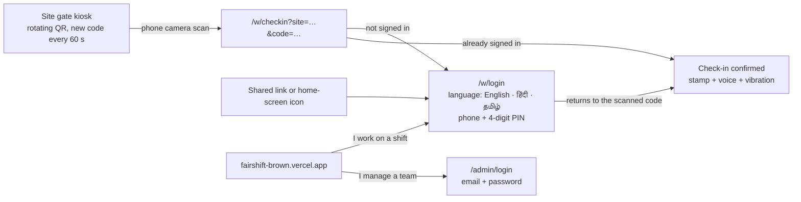
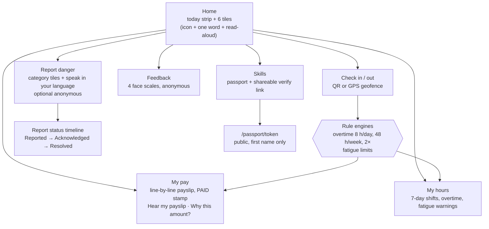
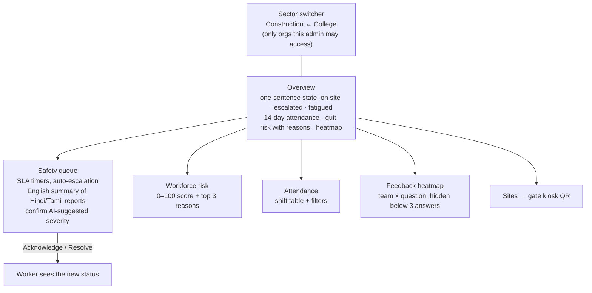
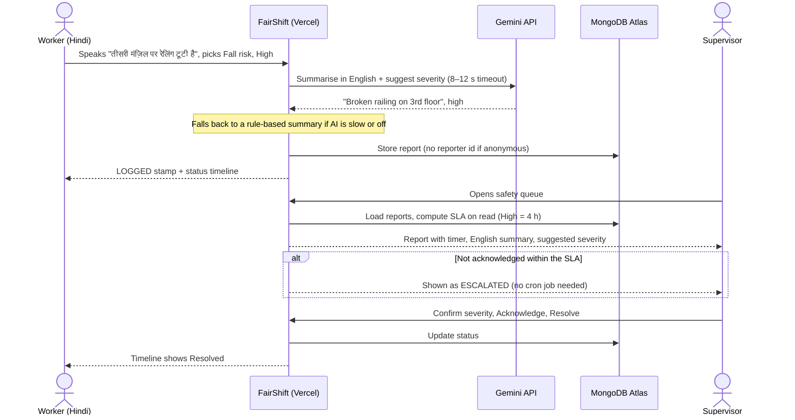
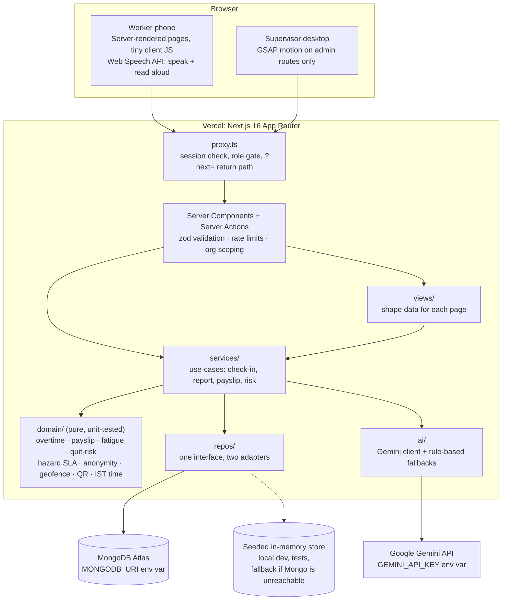

# FairShift: Users, User Flow and Architecture

FairShift has two front doors: a phone app for **shift workers** (`/w`) and a console for **supervisors** (`/admin`). Both read and write the same records, so every action a worker takes appears in the supervisor's queue, and every supervisor action shows up on the worker's phone.

## 1. Who the users are

| Persona                        | Example from the demo data                                                  | Device and context                              | What they need                                                           |
| ------------------------------ | --------------------------------------------------------------------------- | ----------------------------------------------- | ------------------------------------------------------------------------ |
| **Shift worker, construction** | Ramesh Kumar, mason, Skyline Towers, Chennai. Speaks Hindi, daily wage ₹750 | Basic Android phone, outdoors, limited literacy | Proof of hours, a payslip he can understand, a safe way to report danger |
| **Shift worker, campus**       | Murugan Swaminathan, housekeeping, Campus Facilities. Speaks Tamil          | Shared or low-end phone, shift rotas            | Same, plus night-shift fatigue protection                                |
| **Site supervisor**            | Site Ops Lead, Skyline Towers                                               | Desktop or tablet in the site office            | Who is on site, which hazards are overdue, who is overworked             |
| **Regional HR lead**           | Kavya Raman, manages both sites                                             | Laptop                                          | One view across construction **and** campus (sector switcher)            |

## 2. How a user arrives



The QR is scanned with the phone's **own camera app**, so there is nothing to install. If the worker is signed out, the scanned code is carried through login (`?next=`) and the check-in still completes.

## 3. Worker flow



## 4. Supervisor flow



## 5. The closed loop: one hazard, end to end



## 6. Offline check-in and automatic sync

When a worker has poor or no cellular reception at the gate, check-in and other critical actions run entirely offline. Actions are queued in IndexedDB and replayed to the server with their original timestamp as soon as connectivity returns:

```mermaid
sequenceDiagram
    actor W as Worker (offline)
    participant UI as Phone UI (Worker App)
    participant IDB as IndexedDB Outbox
    participant App as FairShift Server Action
    participant DB as MongoDB Atlas

    W->>UI: Captures QR check-in (no connection)
    UI->>IDB: Save in IndexedDB outbox (capturedAt, clientId)
    UI-->>W: Shows "SAVED OFFLINE" stamp ("Will send when online")
    Note over UI,IDB: Worker proceeds to site; action stays local
    Note over UI: Network returns (online event / visibility change)
    UI->>App: flushOutbox replays check-in (code, capturedAt, clientId)
    App->>App: validateCapturedAt (<= 24h, clock skew <= 2m)
    App->>App: verifyRotatingCodeAt(code, siteSecret, capturedAt)
    App->>DB: Shift created with checkIn = capturedAt (idempotent clientId)
    App-->>UI: Replay accepted (success)
    UI->>IDB: Outbox item removed
    UI-->>W: Banner shows "All sent" (auto-hides after 4 s)
```

## 7. Architecture



**Dependency rule:** dependencies point one way only, `pages → services/views → domain + repos`. The `domain/` folder imports nothing from Next.js, the database or the network, so every number on screen comes from a pure function with tests. Gemini only **explains** results. It never decides pay, overtime, risk or deadlines.

**Secrets:** the MongoDB connection string, the Gemini key and the session secret exist only as Vercel environment variables. QR keys and passport tokens are derived from the session secret with HMAC, so the repo contains no secret.
